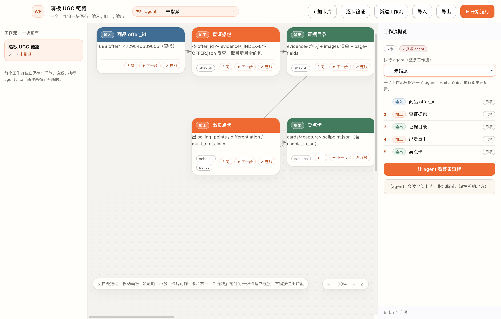
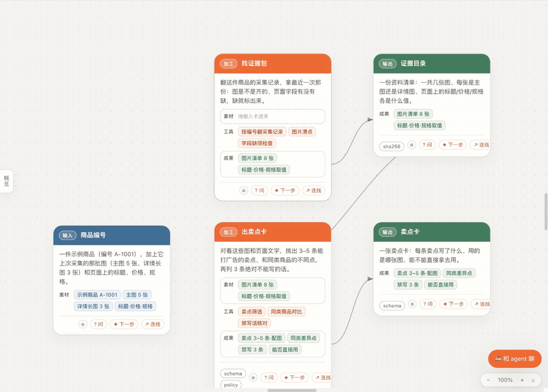
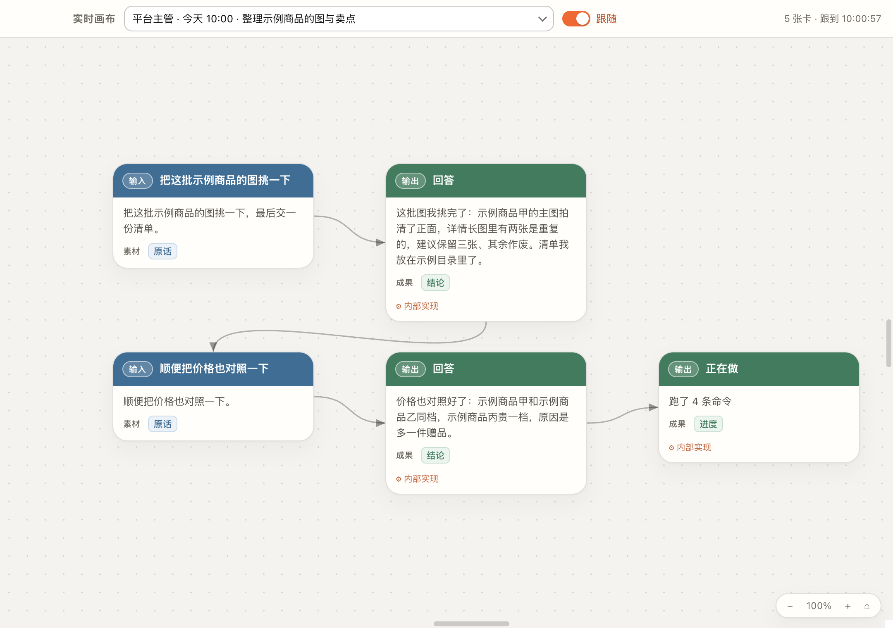
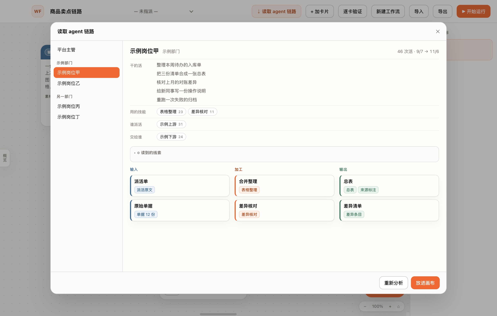
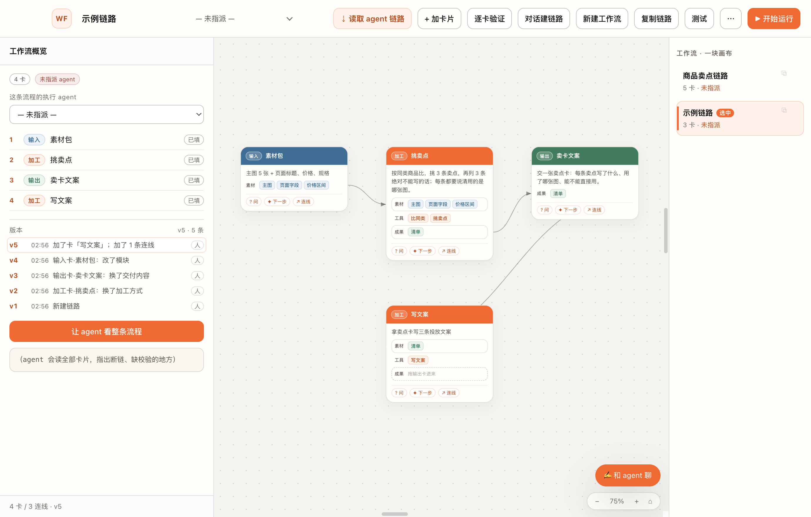

# Workflow Studio · 工作流开发平台

> A desktop canvas for composing agent workflows out of **input / process / output** cards.
> One workflow = one canvas. One agent per workflow. Cards can ask the agent for the next step and add it with one click.



Electron + vanilla JS. No bundler, no framework, no database. `npm install && npm start`.

---

## Why

Most "agent workflow" tools are forms with a run button. This one starts from the way the work
actually flows: **a card is a thing that goes in, a thing that happens, or a thing that comes out.**
You lay the cards out, draw the arrows, and assign one agent to the whole board.

Three ideas it is built around:

1. **Cards are typed** — input (blue), process (orange), output (green). Colour is not decoration:
   it tells you at a glance whether a stage consumes, transforms, or produces.
2. **Assignment is per workflow, not per node.** One board, one owner. No "which agent runs step 4".
3. **The agent is a collaborator, not a black box.** Every card can ask it a question; every card can
   ask it *"what comes next?"* and get 2–4 candidate cards back — click one and it is added and wired in.

## Features

- **Infinite-feel canvas** — the logical origin sits in the middle of a 12000×8000 board
  (`ORIGIN = {x:6000, y:4000}`), so you can pan ~6000px in *every* direction, not just down-right.
  `⌘/Ctrl` + wheel or the ± control zooms **around the viewport centre** (the point under the middle
  stays put); the legend and zoom pill live outside the scroll layer so they never pan away.
- **Cards are never trapped** — dragging is computed in canvas space, so the card follows the cursor even
  while the board auto-scrolls; holding it near an edge keeps scrolling, and releasing scrolls the card
  back into view. No invisible boundary stops a card, and the legend strip no longer swallows drags.
- **Three card types** with coloured header bands and per-card checks (`sha256`, `schema`, …).
- **Cards break down into modules** — an input card lists its **materials** (素材: which images, which data),
  a process card its **tools** (工具: how it picks, compares, checks), an output card its **results**
  (成果: what the delivered file contains). Each module is a short plain-language chip; edit them in the left
  panel (type + Enter to add, click to rename, ✕ to remove). Agents propose modules with every candidate card.
- **Plug a card into a process card to connect it** — a process card has two sockets, 素材 (in) and 成果 (out).
  Drag an input card onto it: the card shrinks into a token above the cursor, the process card lights up, the
  target socket glows and previews the chips that will land there, the other socket dims. Let go: the card
  springs back to size beside the process card (left for materials, right for results, nudged down to avoid
  overlaps), its chips fly into the socket one by one, the edge draws itself in, a pulse runs along it and the
  socket ripples. A drop that would close a loop shakes the socket red and the card springs back. Drag a chip
  back out of a socket to disconnect — the edge retracts. With `prefers-reduced-motion` the result is the same,
  just without the motion.

  
- **Cards are read-only on the canvas** — nothing to click into, so the whole card is a drag handle.
  A single click only selects; **double-click opens that card's info + chat** in the left panel.
  Renaming, rewriting and re-typing happen there (left panel), never on the canvas.
- **Drag-to-connect** — plug an input/output card into a process card's socket (above), or hit `↗ 连线` on any
  card and drop it on another (process → process, anything the sockets don't cover).
- **Two different agents, on purpose** — every workflow picks *its own* executing agent (top bar, overview,
  run dialog). The bottom-right dock is different: it always talks to the **platform supervisor**
  (`default` profile, 平台主管) — planning, dispatch and cross-team review, never card-level work.
- **Real streaming** — the agent runs through `hermes chat --format stream-json`, so tool calls appear one
  row at a time (spinner → `✓ 0.2s`, click for arguments/result), the reply types in as it is produced, and
  the header shows a live 「进行中」 dot. The live turn is patched in place (never re-rendered wholesale), so a
  `思考过程 · N 步` block you fold open/closed stays put while the run is still streaming. Text renders as light markdown (bold / inline code / code blocks /
  lists). `USE_STREAM` in `renderer/app.js` flips back to one-shot text mode when you need the reasoning
  prose — the CLI's JSON stream carries tool events and text, but not the model's thinking.
- **Hermes-style answers** — quiet scaffold rows instead of boxes: tool calls list as one muted line per
  step (`📚 Skill … 0.2s`), the reasoning sits under a `思考 16s · 6095 字` disclosure **open by default**,
  the reply is plain text (no bubble) and only the user's own messages get a bubble. Long answers collapse
  behind `展开全文（N 字）`; while waiting the row counts up 「正在想… Ns」. The workflow agent picker is a
  borderless text control, not a native `<select>` in an orange pill.
- **The left panel is an agent chat** — under the card body sits a chat box wired to the assigned agent:
  type anything (Enter to send), or hit a chip (`评审这张卡` / `✦ 下一步候选` / `看整条流程`). The card,
  its internal wiring and the whole chain ride along as context on every turn.
- **Bottom-right agent dock** — a persistent chat with the **platform supervisor** about the whole
  workflow (the left panel chat is with the workflow's own agent, per card). It answers in plain words, can propose candidate cards, and those
  still need `确认添加` before anything lands on the canvas. `—` folds it into a pill.
- **Next-step cards need your confirmation** — when the agent answers with candidate cards they render as
  buttons inside that message. Clicking one only expands it (name / plain body / ⚙ internal wiring);
  the card is added and wired **only after you press `确认添加`**. The agent never edits the board by itself.
- **Left panel auto-hides** — with no card selected the dialog folds away (canvas gets the space back);
  the `概览` handle on the left edge brings the workflow overview back. The workflow list sits on the right.
- **Per-card validation pass** — walks the chain in edge order, marks each card `ok` / `needs work`, and
  writes the verdict into that card's chat so the history stays with the card.
- **Multiple canvases** — left sidebar lists workflows; each has its own cards, edges and agent; export/import as JSON.
- **Talk a workflow into existence** — 「对话建链路」 opens a temporary canvas: your sentence becomes a draft input card right away, the agent's plan grows card by card while it streams, and 「存成正式」 turns it into a normal workflow (or `✕` throws it away).
- **Copy a workflow** — one click (`复制链路` or the `⧉` on any row) makes an independent copy: cards, edges, modules, wording, executor. Rename suffix keeps the list unambiguous; editing one never touches the other.
- **Watch a real conversation turn into a chain** — 「⋯ → 实时画布」 opens a separate, read-only window: pick a recent conversation (who / when / what it is doing), flip **跟随**, and the canvas shows only what the request was and what came back from it — a card per thing you asked for, plus the file / answer / handoff that was delivered. Reads, commands and lookups do not get cards of their own: they fold into one plain-language line ("read 3 files · ran 2 commands") on that request's card, with every command under **⚙ 内部实现**, and the card turns into the answer in place when the reply lands. Reads are **read-only** (`sqlite3 -readonly` + `?mode=ro`); the window never writes, and closing it leaves the main window — and the conversation — untouched.

  
- **Check before running** — a local static pass flags broken links, process cards missing an input or output, empty cards and chains split in two — each with the card name and how to fix it. A **read-only rehearsal** then asks the executor, card by card, what it would do and what it is missing; it runs with **zero tools** (no commands, no file writes, no messages, no publishing, no spending) and the answers land back on the cards. One click clears them.
- **Radial menu** — press and hold right mouse button (or `Space`) for add / ask / duplicate / delete / validate / run.

## 读取一个 agent 的工作链路

顶栏右边有一个「⇣ 读取 agent 链路」。点开它，左边按分组列出本机装着的 agent（停用的收在最后），选一个就开始。

**它做什么。** 先把这个 agent 自己的说明、它装着的技能、最近实际干过的活翻一遍，再把这份材料交给平台主管，请它把这个人平时反复在做的事，画成一条能看懂的工作流。分析是边算边出：卡片会一张张冒出来。要等多久看它干的活有多少，一般几十秒到两三分钟。

**出来的东西长什么样。** 一张预览，按三段摆开：

- **输入**：它从谁那里拿到什么——谁派的活、上游交来的资料；
- **加工**：它具体怎么干——用哪个本事、怎么挑、怎么比、怎么改；
- **输出**：它交出什么、交给谁。

每张卡下面挂着几个短词模块：输入卡挂素材（用哪些图、哪些数据），加工卡挂工具（拿什么做），输出卡挂成果（交出的文件里有什么）。在这一步不用改，搬进画布再改。

**按「放进画布」之后。** 会新开一条工作流（不会盖掉手上这条），名字按它做的事取；这条流程的执行方自动设成刚读的那个 agent——这些活本来就是它干的；卡片按输入→加工→输出摆好、线也接好，位置摊开不重叠。落地之后就是你自己的一叠卡：改字、换类型、接别的卡、删掉，都和平时一样。

**不满意怎么办。** 点「重来」再算一次；它自己也会在拆得不全、链路断了的时候自动重来一遍。算的时候能看见进展——拆到第几张、等了多久；超过 20 秒没有新内容会明说在等；两分半还没拆完会自己停下、把半截的卡清掉，让你重来，不会一直转圈。中途想换人：直接在左边点另一个 agent，正在跑的那次会真的停下来，结果只属于新选的那个；关掉窗口也会停。

**它读什么、不读什么。** 只读那个 agent 自己的说明、它装着的技能，和它最近干活的记录（派给它的活、它怎么干的、交出了什么）；不碰密钥、凭据和登录信息，也不改那些记录——全程只读打开。



## 版本与回滚

改一条链路，每次完整的改动都会留一版：连续打字算一次，连着挪一下算一次。只把卡片挪个位置不算改动，不留版本。
只保留最近 20 版，更早的自己丢掉。

左栏「概览」最底下是版本列表，一条一行：第几版、几点、改了哪张卡的哪个环节、是人改的还是 agent 提议后应用的。
点其中一行，整条链路就回到那一版——卡片、连线、每张卡的模块、正文、内部实现、执行方一起回去，画布立刻变。

回滚本身也算新的一版，后面的版本不会被删掉，所以回得去、也再回得来。

回滚完再叫 agent，它开口第一句就带上「当前链路版本 vN；你在几点把它回滚到了 vX，之后的改动已作废」。
要是回滚的时候这条链路正有对话在跑，那次运行会被停掉，不会让它在已经作废的链路上接着做。

改一张卡里面的东西也一样：换输入元素、换加工方式、加一个模块、改内部实现，画布上立刻变，共享底稿一秒内跟着写；
停手一会儿或点到别处就记一版，条目写得出是哪张卡的哪个环节（例：加工卡·出图：换了加工方式）。连续打字只算一次，
输入时光标不会跳。改完再叫 agent，它读到的就是改过的新内容。



## 复制、选中、测一测

**复制一条链路。** 顶栏「复制链路」（或右栏每条链路右上角的 `⧉`）就把当前这条复制成一条独立副本：卡片、连线、每张卡的模块、输入元素、加工方式、执行方全都带过去。副本叫「原名（副本）」，重名会继续往后编号。改副本不影响原件，改原件也不影响副本。

**选中的那条。** 右栏里选中的行有一条橘色竖条和「选中」徽标，别的行不标记；关掉窗口重开，选中的还是上次那条。测试只测选中的这一条。

**测试先做两件事。** 顶栏「测试」：

- **静态体检**——不用调模型，本机就算。有没有断链（有卡喂不到、有卡没人接）、加工卡缺输入或缺产出、空卡（只有标题没正文）、连成两截、绕成圈；每条写清是哪张卡、什么问题、怎么补。
- **只读预演**——让这条链路的执行方按卡片顺序走一遍，每张卡回答一句「按现在的写法这一步我会怎么做、缺什么材料」。它**没有任何工具**：跑不了命令、读写不了文件、发不了消息、不发布、不付费，只出结论。结论回填到那张卡上（卡片挂「预演 ✓」、左栏看全文），跑完可以一键「清空预演」，卡上不留残渣。

## Quickstart

```bash
git clone https://github.com/VHKrib/workflow-studio.git
cd workflow-studio
npm install
npm start
```

Requires Node 18+ and the [Hermes Agent CLI](https://hermes-agent.nousresearch.com/docs) on `PATH`
if you want the agent features. Without it the app still runs as a pure canvas.

### How the agent bridge works

The renderer never touches a shell. It talks to the main process through the channels exposed by `preload.js`:

| Channel | Purpose |
|---|---|
| `agents:list` | scan `~/.hermes/profiles/*/profile.yaml` for available agents |
| `agent:ask` | `hermes -p <profile> chat -q "<prompt>"` — one-shot, **read-only Q&A, never executes tools** |
| `agent:stream` / `agent:cancel` | the real streaming run (`--format stream-json`), forwarded event by event; cancel really kills the child |
| `agent:chain` | read-only scan of one agent's own records (`state.db` opened `?mode=ro`), used by 「读取 agent 链路」 |
| `link:read` / `link:write` / `link:drop` | the shared per-workflow state file (`<userData>/links/<id>.json`, atomic write) |
| `version:list` / `version:push` / `version:drop` | snapshots for the last 20 versions + rollback |
| `flow:save` / `flow:open` | export / import a workflow as JSON |

Because questions are one-shot `chat -q` calls with an explicit *"do not execute, do not write files,
do not spend money"* instruction, wiring this to a real production agent is a deliberate separate step.

### Cards speak plain language; code stays inside

A card is read by people, not by a machine. So a card carries two layers:

| Layer | Field | What goes there | Shown on the canvas? |
|---|---|---|---|
| plain language | `body` | 具体：用哪些图 / 哪些数据 → 怎么加工 → 交出什么文件、里面有什么；不写命令、路径、字段名 | **yes** |
| internal wiring | `impl` | the actual commands, scripts, paths, field names the executor needs | no — only the ⚙ panel and the agent see it |

The rule is enforced in three places, not left to the model's goodwill:

1. **prompt** — every `askAgent` call carries the same instruction: plain words **and concrete** —
   which images, which fields, what transformation, what file comes out — with the tech in `impl`;
2. **parser** — `cleanCard()` moves any lingering command/path sentence out of the body into `impl`
   (sentence-level, conservative: it never rewrites text it cannot split cleanly);
3. **load** — old cards whose body is still machine-ish are converted by the `LEGACY_PLAIN` table, so an
   existing board becomes readable without touching the wording of anything else.

A ⚙ chip on a card means "there is internal wiring behind this sentence" — click it to open the panel
section, or edit `impl` in the right panel directly.

### The "next step" protocol

Ask for cards, get strict JSON:

```json
[{ "kind": "proc", "title": "短标题", "body": "这一步要什么/做什么/交出什么", "impl": "执行时真正跑什么：命令/脚本/路径/字段", "mods": ["模块短词"] }]
```

`kind` is `in` | `proc` | `out`. `mods` are the card's modules in plain words (materials / tools / results,
typed by the card's kind); strings or `{name}` objects are both accepted, the prompt's placeholder is dropped.
Two things the parser has to survive:

- **the CLI echoes the question first.** `hermes chat -q` prints `Query: <prompt>` before the answer, and
  the prompt itself contains a `[…]` example — so the parser searches for the **last** bracket span that
  parses as a card array (`jsonArrays`), and drops placeholder cards (`validOpt`).
- **chatty models.** If no JSON is found it falls back to line parsing (`[加工] 标题：内容`).

`agentAnswer()` strips the echo and the trailing session block, so what the panel shows is what the agent
actually said.

## Checks

Two kinds, both run from the repo root. The full handbook (structure, invariants, pitfalls) is
`skills/workflow-studio/SKILL.md`.

**Offline — no app, no network, no model call:**

```bash
node --check renderer/app.js && node --check main.js && node --check chain.js
node skills/workflow-studio/scripts/check-plan.js        # card-splitting rules, one PASS line per case
node skills/workflow-studio/scripts/check-fixtures.js    # replay the archived real answers in fixtures/ (8 samples, a few ms)
node tools/scan-public.js                                # public-repo hygiene scan, expects "0 命中"
```

**Against a running instance — CDP.** Start your own instance on its own port *and* its own data dir,
then point the scripts at that port (they read `CDP_PORT`; never reuse a window that is already open):

```bash
./node_modules/.bin/electron . --remote-debugging-port=9333 --user-data-dir=$TMPDIR/wf-9333 &
export CDP_PORT=9333
node skills/workflow-studio/scripts/cdp-canvas.js    # pan / zoom anchor / drag / auto-scroll / layout
node skills/workflow-studio/scripts/cdp-click.js --card "<card title>" --mode double
node skills/workflow-studio/scripts/cdp-dock.js      # plug a card into a socket, reject a loop, unplug
node skills/workflow-studio/scripts/cdp-version.js   # 5 edits = 5 versions, merges, keep 20, rollback
node skills/workflow-studio/scripts/cdp-edit.js      # editing inside a card is a version too
node skills/workflow-studio/scripts/cdp-copy.js      # duplicate / remembered selection / static check
node skills/workflow-studio/scripts/cdp-live.js      # temp canvas + shared state file + external claim
node skills/workflow-studio/scripts/cdp-read.js --agent <id>              # reads one real agent's records
node skills/workflow-studio/scripts/cdp-read-stability.js --agent <id> --mode kill
```

Everything above is local except `cdp-read*`, `cdp-copy.js --preview` and the `--chat` flags, which call a
real agent once each.

## Data model

```js
store = { workflows: [{ id, name, agent, nodes: [], edges: [] }], current: workflowId }
node  = { id, kind: 'in'|'proc'|'out', title, body, impl, mods: [], checks: [], chat: [], x, y, status }
mod   = { id, type: 'mat'|'tool'|'res', name }      // 素材 / 工具 / 成果，跟着卡片类型走
edge  = [fromId, toId]                               // 插槽里显示什么由连线推出来，不单独存
chat  = [{ role: 'me'|'agent', text, at, opts? }]   // 每张卡自己的对话，opts 是那次回答里的候选卡
preview = { at, ok, secs, steps, text }             // 只读预演结论：只活在这台机器上，不进状态文件与版本快照
```

Persisted to `localStorage['tcflow.v4']` (v3 boards are migrated on first load: `impl` is filled in,
old seed copy is rewritten in plain language). Execution order is derived (`chainOrder`): a DFS from every
node with no incoming edge. Nothing is stored server-side; export the JSON if you want it in git.

## Project layout

```
main.js            Electron main: window, agent list, chat bridge, file dialogs
preload.js         contextBridge -> window.tcflow
chain.js           read-only scan of another agent's own records (profile, skills, state.db)
livefeed.js        read-only session feed: recent conversations across profiles + message increments
actmap.js          conversation actions -> chain cards (pure: merge, update in place, plain-language front)
linkstore.js       the shared per-workflow state file (<userData>/links/<id>.json)
versions.js        version snapshots, trimmed to the newest 20
renderer/
  index.html       top bar, canvas, side panel, run dialog, radial menu
  app.js           state, card render, edges, pan/zoom, radial menu, option parsing
  live.html        the separate read-only live canvas window (pick a conversation + follow switch)
  live.js          live canvas: render the feed doc, wrap layout, follow tail, remember state
  style.css        design tokens (paper #f5f3ef / ink #111 / orange #ff5a1f)
  live.css         only what the live window adds (bar, switch, impl fold)
tools/shot.js      CDP screenshot helper (reads CDP_PORT, defaults to 9222)
tools/eval.js      CDP evaluate helper (headless DOM assertions)
tools/verify-actmap.js  offline check: a real conversation -> which cards (no network, no model)
tools/scan-public.js  scans everything git tracks for names/paths that must not go public
docs/              screenshot + the socket animation (dock.gif, recorded by cdp-dock.js --record)
skills/            workflow-studio: development handbook, CDP checks, and fixtures/ with archived answers
CHANGELOG.md       what changed, version by version
```

## Design notes

The palette and radius come from the platform's shared design tokens
(cream paper, near-black ink, one orange accent). Cards use three semantic colours on the header band
only — the body stays paper-white so text keeps contrast. Nothing animates on hover except a 1px border
and a soft ring; motion is saved for one moment — plugging a card into a socket. The canvas itself is a dot
grid at 22px.

## Roadmap

- [ ] real execution: run a card against a tool, with an approval gate per paid action
- [ ] workflow-level checks (schema between cards, not just per card)
- [ ] import/export of a library of reusable cards
- [ ] optional HTTP transport instead of CLI for the agent bridge

## 中文说明

把业务链路画成卡片：**输入（蓝）→ 加工（橙）→ 输出（绿）**，一张卡一个环节，箭头连成流程。
**卡片上只写人话**：读卡的人不需要懂代码；命令、脚本、路径、字段名收进「⚙ 内部实现」，卡片正面不显示。
**用到的东西拆成模块**：输入卡写素材、加工卡写工具、输出卡写成果，每块一个短词。
**拖卡就是连线**：把输入卡拖到加工卡的「素材」插槽、输出卡拖到「成果」插槽，松手就接上；把模块从插槽里拖出来就断开。
一条工作流只指派一个 agent；任何卡片都能问 agent，也能让它给「下一步」候选卡，点一下自动加卡并连线。
界面：空白处拖动＝平移画板，`⌘`+滚轮＝缩放，右键按住＝转盘菜单。

## License

MIT — see [LICENSE](LICENSE).
