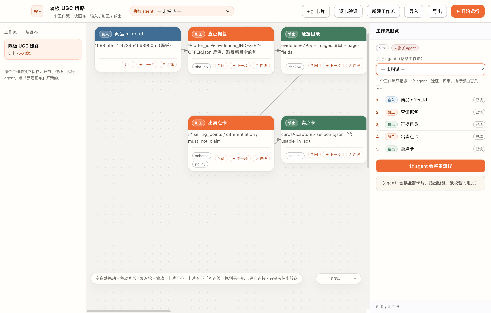
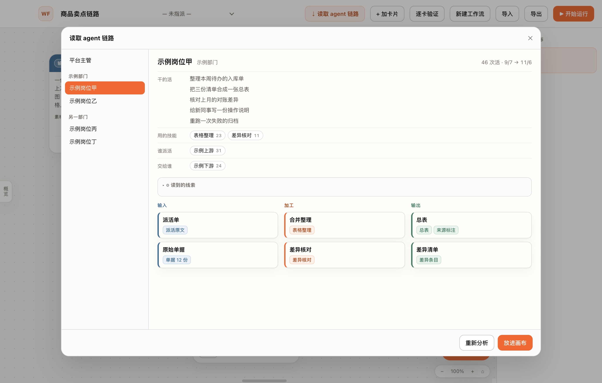
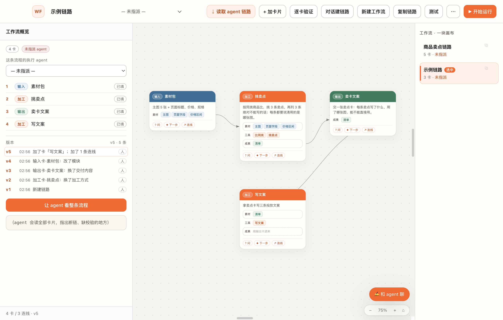

# Workflow Studio · 工作流开发平台

**给「一人公司」的多工作流并线开发台。**
底层是 [Hermes Agent](https://hermes-agent.nousresearch.com/docs) 的多 agent 班组；这个应用是那块画布——
几条工作流同时开发、边跑边改、随时回到任意一版，都不用停机。



Electron + 原生 JS，没有打包器、没有框架、没有数据库。`npm install && npm start` 就能跑。

[English](README.md)

---

## 它是什么

活通常不是一条一条来的。一个人同时跑好几条线：调研、采集、生产、发布——每条线有自己的 agent，每条线都在跑的时候还在改。

Workflow Studio 把「工作流」当成**活文档**：

- **一条工作流＝一块卡片画布**。每张卡要么是输入、要么是加工、要么是输出。卡片正面只写人话，命令、路径、字段名收进卡片的「内部实现」。
- **几条工作流并排存在**。每条有自己的卡片、连线和执行方；一键切换，一键复制出一条独立副本去做试验。
- **热修改**。工作流在用的时候直接改卡片：画布、共享底稿、agent 的下一轮，看到的立刻是新版本。不用导出、不用重新生成、不用重启。
- **热回滚**。每一次完整的改动都留一版（保留最近 20 版）。点一行就把整条链路退回去——卡片、连线、模块、正文、内部实现、执行方一起回去。回滚本身也记一版，所以退得回去、也再回得来。回滚时如果还有对话在跑，会当场停掉，不会让它在作废的链路上继续干。
- **能从一个正在干活的 agent 身上读出链路**。选一个 agent，只读地翻它自己的说明、技能和最近的干活记录，再把这条链路画成卡片，你点头才落进新工作流。
- **不会背着你改东西**。agent 给的是候选卡，按下「确认添加」才上画布。

## 为什么是这样

1. **卡片有类型**——输入（蓝）、加工（橙）、输出（绿）。颜色就是含义：这一环节是在吃进、在处理，还是在产出。
2. **指派是按工作流，不是按节点**。一块画布一个负责人，不用纠结「第 4 步谁来跑」。
3. **agent 是协作者，不是黑盒**。任何一张卡都能问它，也能问它「下一步做什么」，它会回 2–4 张候选卡。
4. **人读卡片，agent 读接线**。卡片说的是「什么进、做什么、什么出」，真正能执行的东西在下面一层（⚙）。

## 功能

- **画布没有边界感**——逻辑原点在 12000×8000 画板的正中间，四个方向各能推 ~6000px。`⌘/Ctrl` + 滚轮或缩放条围绕视口中心缩放；图例和控制件在滚动层之外，不会跟着跑掉。
- **卡片拖不丢**——拖动按画布坐标算，画板自动滚动时卡片仍跟着光标；松手会把卡片滚回视野。
- **三种卡片**，带颜色标题带，每张卡可以挂校验（`sha256`、`schema` 等）。
- **卡片拆成模块**——输入卡挂素材、加工卡挂工具、输出卡挂成果，每块一个短词，在侧栏里改。
- **把卡插进加工卡就连上**——输入卡拖到「素材」插槽、输出卡拖到「成果」插槽：卡片缩成小方块、插槽预览将要落进来的东西、松手后模块一个个飞进去、连线自己画出来。会绕成圈的接入会被拒绝；把模块拖出来就断开。开了「减少动态效果」结果一样，只是没有动画。
- **画布上的卡片只读**——整张卡就是拖动把手；单击是选中，双击在侧栏打开这张卡的信息和对话。
- **两种 agent 各司其职**——每条工作流自己指定执行方；右下角常驻那个永远跟平台主管聊（规划、派活、跨岗复核，不接单张卡）。
- **真流式**——走 `hermes chat --format stream-json`：工具调用一行一行冒出来（转圈 → `✓ 0.2s`，点开看参数和结果），回复边生成边打字，折叠的思考块在流式过程中不会被冲掉。CLI 的 JSON 流只带工具事件和文本、不带模型思考过程；想看推理原文可以把 `USE_STREAM` 关掉走一次性输出。
- **回答是清爽的脚手架样式**——工具行、思考折叠、「展开全文」，只有你自己说的话才有气泡。
- **侧栏就是一个 agent 对话**——直接打字，或者点快捷条（*评审这张卡* / *下一步候选* / *看整条链*）。卡片、接线、整条链都会作为上下文一起带过去。
- **候选卡要你确认**——候选以按钮形式出现在回答里，点一下只是展开，按下「确认添加」才真正上画布并连线。
- **逐卡验证**——按连线顺序走一遍，把每张卡标成 `ok` / `待补`，结论写进那张卡自己的对话里。
- **把工作流聊出来**——开一块临时画布：你说一句话先变一张草稿输入卡，方案边流式边长卡，满意了「存成正式」，不满意丢掉。
- **复制一条工作流**——一键得到独立副本（卡片、连线、模块、措辞、执行方全带上），改哪边都不影响另一边。
- **看着一段真实对话长成链路**——另开一个只读窗口跟一条 Hermes 对话：一个请求一张卡，读文件/跑命令折成一行「读了 3 个文件 · 跑了 2 条命令」，最终交付的文件或回答就是输出卡。数据库用 `sqlite3 -readonly` + `?mode=ro` 打开，只跑 SELECT。
- **跑之前先检查**——本机静态体检（断链、缺输入缺产出、空卡、被拆成两截、绕圈，逐条说怎么补）；再做一次**只读预演**：执行方按卡片顺序说会怎么做、缺什么，全程**零工具**（不跑命令、不读写文件、不发消息、不发布、不花钱）。
- **转盘菜单**——按住鼠标右键（或 `Space`）出：添加 / 提问 / 复制 / 删除 / 验证 / 运行。

## 读取一个 agent 的工作链路

顶栏的 **读取 agent 链路**：选一个本机装着的 agent，它会

1. 只读地翻这个 agent 自己的说明、装着的技能、最近实际干过的活——不碰密钥、凭据和登录信息；
2. 把这份材料交给平台主管，请它把这个人反复在做的事画成三段：**输入**（从谁那里拿到什么）、**加工**（具体怎么做）、**输出**（交出什么、交给谁）；
3. 卡片边算边长出来，一般几十秒到两三分钟。

按「放进画布」就变成一条新工作流：名字按它做的事取、执行方自动设成那个 agent、卡片按输入→加工→输出摆好、线也接好。点「重来」可以再算一次；中途换 agent 会真的停掉上一次；全程不会写那个 agent 的记录。



## 版本与回滚

每一次完整的改动都留一版——连着打字算一次，只挪位置不算。只保留最近 20 版。

版本列表在「概览」最底下：第几版、几点、改了哪张卡的哪个环节、是人改的还是 agent 提议后应用的。点一行，整条链路回到那一版——卡片、连线、模块、正文、内部实现、执行方一起回去。回滚本身也记一版，所以后面的版本还在，随时能再回去。

回滚时如果正有对话在跑，会被停掉，不会让它在已经作废的链路上继续。下一轮 agent 开口就带上「当前链路版本 vN；在几点回滚到了 vX」。



## 跑之前先测

- **静态体检**（本机、不调模型）：断链、加工卡缺输入或缺产出、空卡、连成两截、绕成圈——每条写清是哪张卡、怎么补。
- **只读预演**：执行方按卡片顺序，一张卡回答一句「按现在这么写我会怎么做、缺什么」。它**没有任何工具**：跑不了命令、读写不了文件、发不了消息、不发布、不付费。结论回填到卡片上，可以一键清空。

## 快速开始

```bash
git clone https://github.com/VHKrib/workflow-studio.git
cd workflow-studio
npm install
npm start
```

需要 Node 18+；想用 agent 相关功能，还要把 [Hermes Agent CLI](https://hermes-agent.nousresearch.com/docs) 放在 `PATH` 里。没有它，画布本身照样能用。

### macOS / Windows / Linux

Electron 三平台都跑，这个应用没有原生模块，同一份源码直接能用。

| 平台 | 怎么开 |
|---|---|
| macOS | 双击 `open-workflow-studio.command`，或 `npm start` |
| Windows | 双击 `open-workflow-studio.bat`（第一次会自动装依赖），或 `npm start` |
| Linux | `npm start` |

平台差异都收在 `platform.js`，由 `npm run test:platform` 覆盖：

- Hermes CLI 的位置（mac/linux 是 `.../bin/hermes`，Windows 是 `hermes.cmd`，要走 shell）；
- `sqlite3` 的查找（mac 优先 `/usr/bin/sqlite3`，Windows 查 `sqlite3.exe` 或常见安装路径）；
- 快捷键文案（macOS 显示 `⌘Z`，其它平台 `Ctrl+Z`）；
- `workflow-studio://` 协议在 mac/Windows 可登记，Linux 要打包后才生效。

### 打包

默认还是 `npm i && npm start`；打包是可选项，`electron-builder` 走 `npx` 按需下载，依赖表里仍然只有一个包。

```bash
npm run dist:mac     # -> dist/*.dmg
npm run dist:win     # -> dist/*.exe（NSIS 安装包，在 Windows 上打）
npm run dist:linux   # -> dist/*.AppImage
```

产物在 `dist/`（已 gitignore），配置在 `package.json` 的 `build` 里。默认不签名，要签名/公证就配 electron-builder 的常规环境变量（`CSC_LINK`、`CSC_KEY_PASSWORD`、`WIN_CSC_LINK`）。图标不放就是 Electron 默认图标，放 `build/icon.icns`（macOS）或 `build/icon.ico`（Windows）即可。

## agent 桥是怎么接的

渲染层不碰 shell，全部走 `preload.js`：

| 通道 | 用途 |
|---|---|
| `agents:list` | 扫 `~/.hermes/profiles/*/profile.yaml` 列出可用 agent |
| `agent:ask` | `hermes -p <profile> chat -q "<prompt>"`——一次性、**只读问答，绝不执行工具** |
| `agent:stream` / `agent:cancel` | 流式运行（`--format stream-json`），逐事件转发；取消会真的杀掉子进程 |
| `agent:chain` | 只读扫一个 agent 自己的记录（`state.db` 用 `?mode=ro` 打开） |
| `link:read` / `link:write` / `link:drop` | 每条工作流共享的底稿文件（`<userData>/links/<id>.json`，原子写） |
| `version:list` / `version:push` / `version:drop` | 最近 20 版快照与回滚 |
| `flow:save` / `flow:open` | 工作流导出 / 导入 JSON |

因为提问都是一次性 `chat -q`，并且明确写了「不要执行、不要写文件、不要花钱」，把这里接到真正的生产 agent 上是刻意的另一步。

## 卡片说人话，代码收在里面

| 层 | 字段 | 写什么 | 画布上显示吗 |
|---|---|---|---|
| 人话 | `body` | 用哪些图、哪些数据 → 怎么加工 → 交出什么文件、里面有什么；不写命令、路径、字段名 | **显示** |
| 内部实现 | `impl` | 真正要跑的命令、脚本、路径、字段名 | 不显示——只有 ⚙ 面板和 agent 看得到 |

三处一起保证：**提示词**要求「具体但说人话」，**解析器**（`cleanCard()`）把残留的命令/路径句挪进 `impl`，**加载时**用老卡映射表把机器的说法改成人话。卡片上的 ⚙ 就表示「这句话背后有接线」。

## 「下一步」协议

```json
[{ "kind": "proc", "title": "短标题", "body": "这一步要什么/做什么/交出什么",
   "impl": "执行时真正跑什么：命令/脚本/路径/字段", "mods": ["模块短词"] }]
```

`kind` 是 `in` / `proc` / `out`；`mods` 是卡片的模块短词。解析器找的是**最后**一个能解析成卡片数组的括号段（CLI 会先把提问回显一遍，而提问里本身带着示例），会丢掉占位卡；模型不返回 JSON 时退回按行解析（`[加工] 标题：内容`）。`agentAnswer()` 负责切掉回显和结尾的会话块。

## 检查

离线——不用开应用、不联网、不调模型：

```bash
node --check renderer/app.js && node --check main.js && node --check chain.js
node skills/workflow-studio/scripts/check-plan.js        # 拆卡规则
node skills/workflow-studio/scripts/check-fixtures.js    # 重放归档的真实回答
node tools/scan-public.js                                # 公开仓库内容扫描
npm run test:platform                                    # 三平台解析
```

对着运行中的实例——自己起一个独立端口**和独立数据目录**的实例，再把 `CDP_PORT` 指过去：

```bash
./node_modules/.bin/electron . --remote-debugging-port=9333 --user-data-dir=$TMPDIR/wf-9333 &
export CDP_PORT=9333
node skills/workflow-studio/scripts/cdp-canvas.js    # 平移 / 缩放锚点 / 拖动 / 自动滚动
node skills/workflow-studio/scripts/cdp-dock.js      # 插卡、拒绝成环、拔卡
node skills/workflow-studio/scripts/cdp-version.js   # 版本、合并、保留 20、回滚
node skills/workflow-studio/scripts/cdp-edit.js      # 卡内编辑也算一版
node skills/workflow-studio/scripts/cdp-live.js      # 临时画布 + 共享底稿
node skills/workflow-studio/scripts/cdp-read.js --agent <id>
```

## 数据模型

```js
store = { workflows: [{ id, name, agent, nodes: [], edges: [] }], current: workflowId }
node  = { id, kind: 'in'|'proc'|'out', title, body, impl, mods: [], checks: [], chat: [], x, y, status }
mod   = { id, type: 'mat'|'tool'|'res', name }
edge  = [fromId, toId]
chat  = [{ role: 'me'|'agent', text, at, opts? }]
preview = { at, ok, secs, steps, text }   // 预演结论，只在本机
```

存在 `localStorage['tcflow.v4']`（v3 的画板第一次加载时自动迁移）。执行顺序是推出来的（`chainOrder`）：从每个没有入边的节点开始 DFS。服务端不存任何东西——想进 git 就导出 JSON。

## 目录

```
main.js            Electron 主进程：窗口、agent 列表、对话桥、文件对话框
platform.js        跨平台：hermes/sqlite3 路径、快捷键文案
preload.js         contextBridge -> window.tcflow
chain.js           只读扫另一个 agent 的记录（profile、skills、state.db）
livefeed.js        只读会话流：各 profile 最近对话
actmap.js          对话动作 -> 链路卡片（纯函数）
linkstore.js       每条工作流共享的底稿文件
versions.js        版本快照，只留最近 20 版
renderer/          index.html / app.js / live.html / live.js / style.css / live.css
tools/             CDP 辅助、平台单测、公开内容扫描
docs/              截图与插卡动画
skills/            开发手册、CDP 检查脚本、归档样例
```

## 设计说明

奶油纸色、近黑墨色、一个橙色强调色；三种语义颜色只用在标题带上——正文保持纸白，保证对比度。悬停只有 1px 边框和一圈柔光；动画只留给一个时刻：把卡片插进插槽。画布是 22px 的点阵。

## 路线

- [ ] 真正的执行：让卡片真的调工具，每个花钱的动作都要过审批
- [ ] 工作流级检查（卡与卡之间的 schema，而不只是单卡）
- [ ] 可复用卡片库
- [ ] agent 桥可选 HTTP，不只 CLI

## 许可

MIT —— 见 [LICENSE](LICENSE)。
